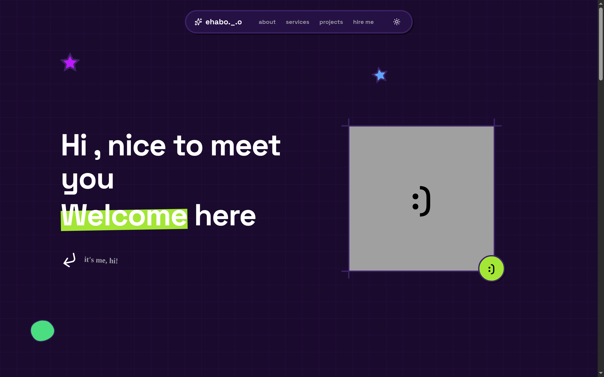
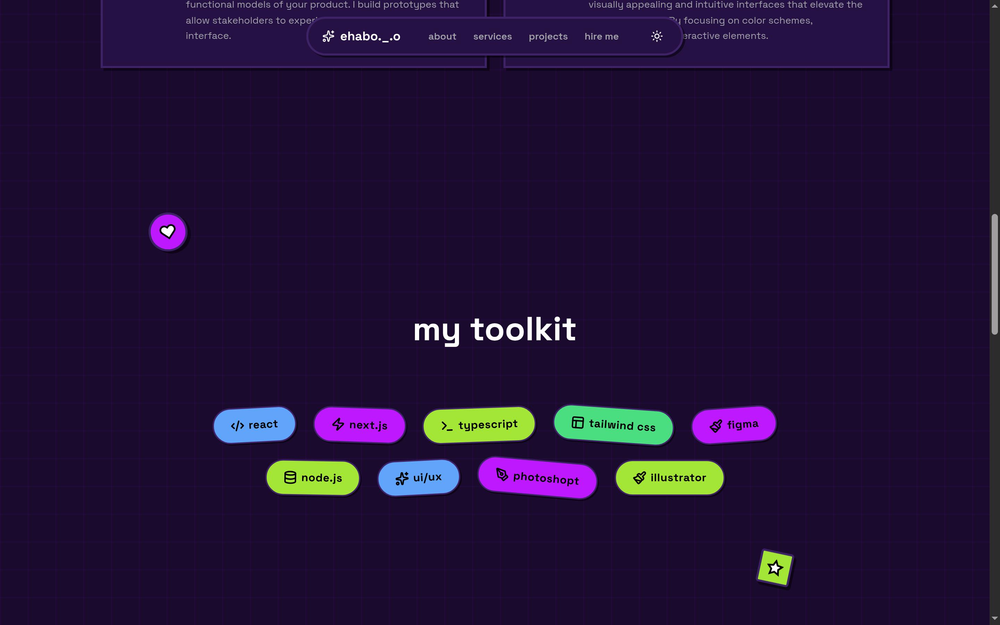
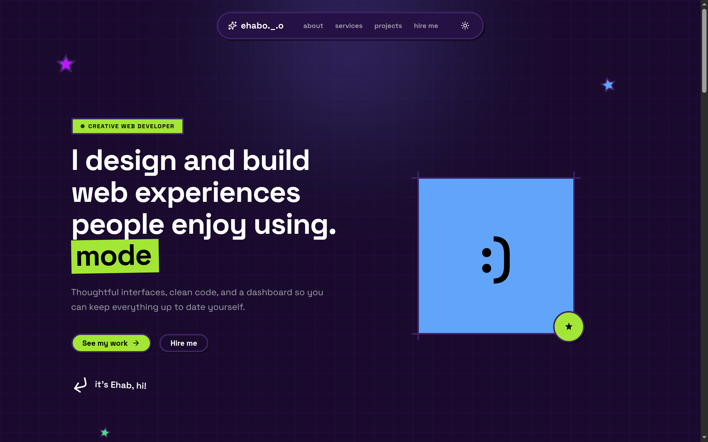
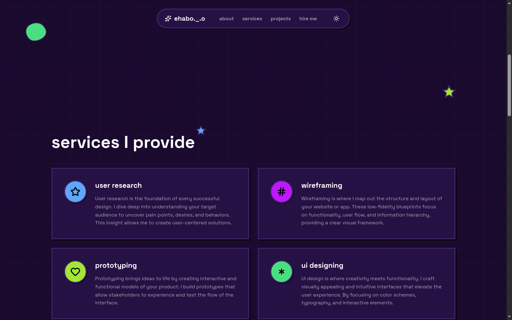
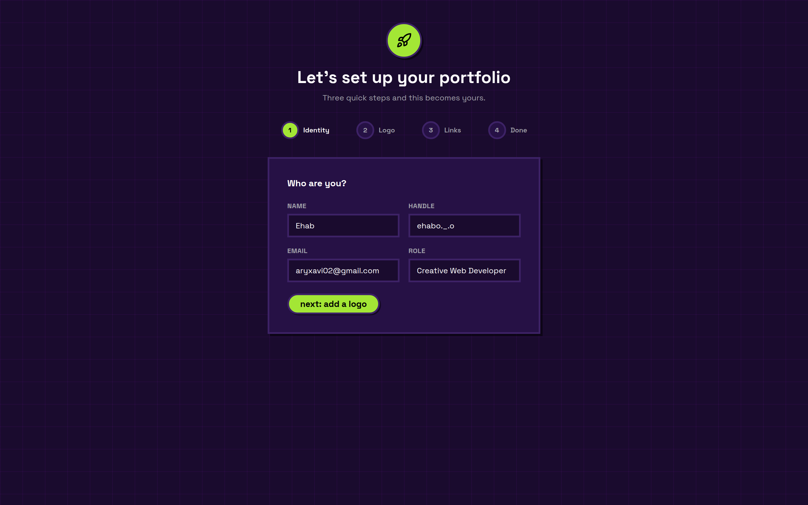
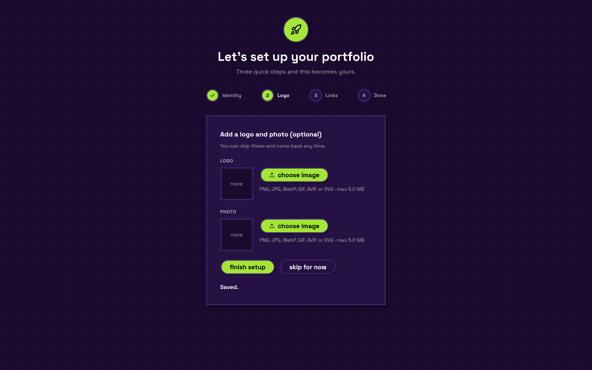
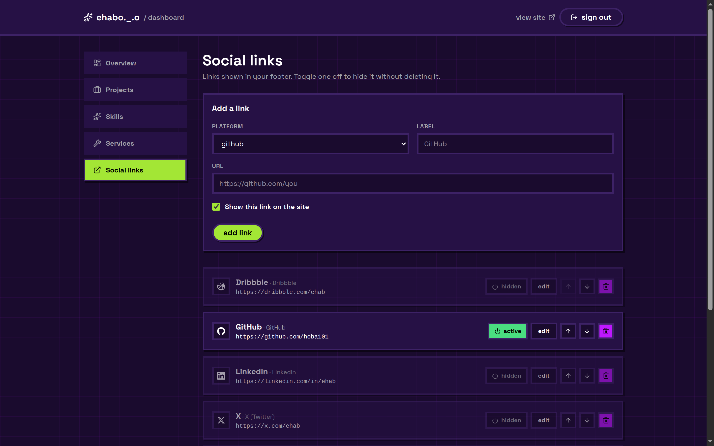
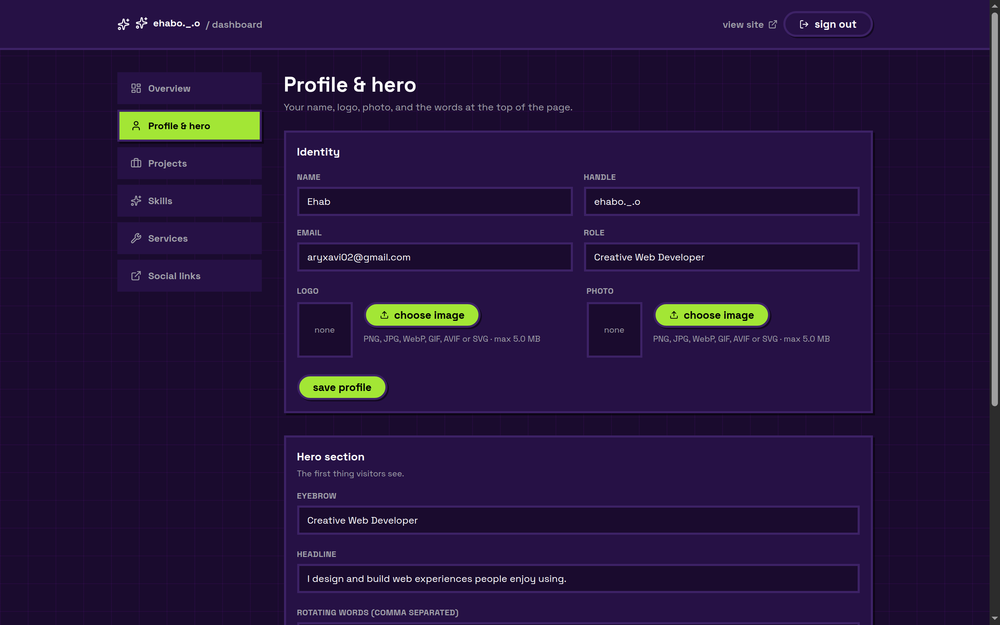
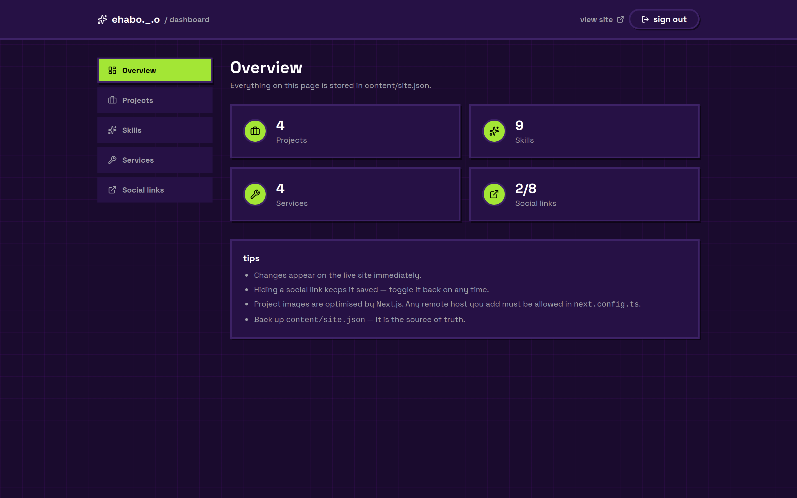

<div align="center">

# Ehab — Portfolio

**A neo-brutalist portfolio with a built-in content dashboard.**
Next.js 16 · React 19 · Tailwind CSS v4 · TypeScript

[Live site](#) · [Dashboard](#dashboard) · [Quick start](#quick-start)

</div>

---

## Preview

<div align="center">

</div>

<div align="center">
<table>
<tr>
<td width="50%"></td>
<td width="50%"></td>
</tr>
<tr>
<td align="center"><em>Light theme</em></td>
<td align="center"><em>Skills as scattered stickers</em></td>
</tr>
</table>
</div>

<div align="center">

<em>The hero — CSS-only parallax, gradient glow and a typewriter, no animation library</em>
</div>

A single-page portfolio rendered as a Server Component, with a password-protected
dashboard for editing projects, skills, services and social links — no database,
no external CMS, no rebuild required.

---

## Highlights

| | |
| --- | --- |
| **Zero-dependency CMS** | A dashboard at `/dashboard` writes straight to `content/site.json`. Changes appear instantly. |
| **Non-leaking auth** | `proxy.ts` blocks `/dashboard` *before* any route renders, not just after. |
| **Server Components** | The public page ships minimal JavaScript; only the nav and reveal animations hydrate. |
| **Accessible** | Skip link, focus-visible rings, semantic landmarks, `prefers-reduced-motion`. |
| **Progressive enhancement** | Server HTML stays visible and indexable even with JavaScript disabled. |
| **Neo-brutalist design** | One token-driven theme with full dark mode, shared across the whole site. |

---

## Features

### Portfolio
- **Hero** — animated typography with hand-rolled SVG decorations
- **Services** — 2×2 brutalist card grid with per-card accent colour and icon
- **Skills** — scattered, tilted "sticker" pills with hover physics
- **Projects** — photo cards with image optimisation and optional project links
- **Contact** — call-to-action plus a footer whose social links you control

<div align="center">
<table>
<tr>
<td width="50%"></td>
<td width="50%"></td>
</tr>
<tr>
<td align="center"><em>Services grid</em></td>
<td align="center"><em>Password-protected dashboard</em></td>
</tr>
</table>
</div>

### Dashboard
- **Full CRUD** — add, edit, delete and reorder projects, skills and services
- **Image uploads** — logo, photo and project images uploaded straight from the dashboard
- **Social link management** — GitHub, LinkedIn, X, Instagram, Facebook, Behance, Dribbble, YouTube
- **Activate / deactivate toggle** — hide a link from the footer without deleting it
- **Hero editor** — change the headline, subheadline, rotating words and both CTAs
- **Profile editor** — name, handle, email, role, logo and photo
- **Password auth** — HMAC-signed, expiring `httpOnly` cookie
- **Zero dependencies** — filesystem storage, no database required

### Setup wizard
On first visit the dashboard runs a short guided setup instead of showing an
empty editor: identity → logo → links → done. Anyone who clones the repo can
have a finished portfolio in a couple of minutes, in the same neo-brutalist
style.

<div align="center">
<table>
<tr>
<td width="50%"></td>
<td width="50%"></td>
</tr>
<tr>
<td align="center"><em>Step 1 — who are you?</em></td>
<td align="center"><em>Step 2 — add a logo</em></td>
</tr>
</table>
</div>

### Engineering
- **Scroll-triggered reveals** driven by `IntersectionObserver`, gated behind
  `@media (scripting: enabled)` so content never depends on JS to be seen
- **Animated hero with no JS libraries** — scroll-linked parallax via
  `animation-timeline`, a ~40-line typewriter, and CSS-only ambient glow
- **Uploads with real validation** — MIME allowlist, 5 MB cap, generated
  filenames, and a path-traversal guard on the serving route
- **Atomic content writes** — write to a temp file, then `rename()`, so a crash
  mid-write cannot corrupt `site.json`
- **Always-fresh content** via `connection()`, so edits are never served stale
- **SEO built in** — generated Open Graph image, `sitemap.xml`, `robots.txt`
- **Optimised images** through `next/image` with explicit `remotePatterns`
- **Error boundaries** — `error.tsx`, `loading.tsx`, `not-found.tsx`

---

## Dashboard

<div align="center">

</div>

<div align="center">

<em>Profile &amp; hero editor — change your words and upload a logo or photo</em>
</div>

Every save is written directly to **`content/site.json`** and shows up on the
site immediately — no rebuild, no redeploy.

<div align="center">

</div>

```bash
cp .env.example .env.local    # then set DASHBOARD_PASSWORD
npm run dev
```

Open <http://localhost:3000/dashboard> and sign in.

<details>
<summary><b>Environment variables</b></summary>

| Variable | Required | Purpose |
| --- | --- | --- |
| `DASHBOARD_PASSWORD` | ✅ | Password for `/dashboard`. Without it the dashboard stays locked and shows setup instructions. |
| `DASHBOARD_SECRET` | ➖ | Optional salt for the session cookie signature. Changing it invalidates existing sessions. |

</details>

`content/site.json` is the **source of truth** — back it up. It is valid JSON,
so you can also edit it by hand; the dashboard simply reads and writes the same
file.

---

## Physics learning platform

The dimensional-analysis course that used to live at `/physics` has been split
out into its own standalone project: **`~/physics-platform`**. This repo is now
the portfolio and dashboard only.

> Chapter 1 (*Units & Dimensions*) is built; the remaining twelve chapters are
> scaffolded and locked.

---

## Tech stack

| Layer | Choice |
| --- | --- |
| Framework | Next.js 16 (App Router, Turbopack) |
| UI | React 19 + React Compiler |
| Styling | Tailwind CSS v4 |
| Language | TypeScript (strict) |
| Icons | lucide-react |
| Theming | next-themes |
| Auth | HMAC-SHA256 signed cookies via `node:crypto` |
| Linting | ESLint 9 (flat config) |

---

## Getting started

**Requirements:** Node.js 20.9+

```bash
git clone https://github.com/hoba101/my-website.git
cd my-website
npm install

cp .env.example .env.local   # set DASHBOARD_PASSWORD
npm run dev
```

Open <http://localhost:3000>.

### Scripts

```bash
npm run dev     # dev server
npm run build   # production build
npm run start   # serve the production build
npm run lint    # ESLint
```

---

## Architecture

```
app/
├── page.tsx              # assembles the page from content/site.json
├── layout.tsx            # fonts, theme provider, skip link, metadata
├── opengraph-image.tsx   # social share card, generated from the profile
├── sitemap.ts / robots.ts
├── media/[...path]/      # serves uploaded images
├── actions/              # Server Actions — every one re-checks auth
│   ├── auth.ts           #   login / logout
│   ├── content.ts        #   CRUD, reorder, toggle, profile, hero
│   └── upload.ts         #   image upload
├── components/           # hero, services, skills, projects, contact
│   ├── HeroSection.tsx   # animated hero (CSS-first motion)
│   ├── Typewriter.tsx    # ~40 lines, no animation library
│   ├── Logo.tsx          # uploaded logo, or Sparkles fallback
│   ├── InView.tsx        # scroll-reveal wrapper
│   └── SocialIcons.tsx   # hand-rolled brand SVGs
├── dashboard/            # admin UI (auth-gated)
│   ├── login/            # outside the auth gate, no redirect loop
│   ├── setup/            # first-run wizard
│   └── (admin)/          # route group: protected pages only
│       └── profile/      # profile + hero editor
├── lib/
│   ├── content.ts        # read/write site.json (atomic)
│   ├── uploads.ts        # server-side upload validation + storage
│   ├── uploads-shared.ts # client-safe constants (no node:* imports)
│   ├── auth.ts           # session sign + verify
│   └── icons.ts          # icon registry
└── hooks/useInView.ts    # IntersectionObserver hook

content/site.json         # all editable content
content/uploads/          # uploaded images
proxy.ts                  # guards /dashboard before render
docs/                     # screenshots used in this README
```

### Why uploads don't live in `public/`

Next.js snapshots `public/` into memory **once, when the server boots**. A
file uploaded after that point returns 404 until the server restarts, so
runtime uploads would appear to work and then break. `content/uploads/` is
served instead by `app/media/[...path]/route.ts`, which reads from disk on
every request.

Two config flags back this up in `next.config.ts`:

- `serverActions.bodySizeLimit` — the default 1 MB rejects anything useful
- `proxyClientMaxBodySize` — `proxy.ts` covers `/dashboard/*`, and its default
  **silently truncates** the request body rather than erroring

### Why `proxy.ts` exists

Guarding `/dashboard` in a layout is **not sufficient**. Those pages call
`connection()` so content is always fresh — and React then streams the page
render *concurrently* with the layout. That flushed the entire dashboard HTML
into the response body for anonymous visitors: the browser would bounce, but
anyone reading the raw response got the whole admin UI.

`proxy.ts` runs before any route renders, so the dashboard is never rendered
for an unauthenticated request at all.

### Why reveal animations use `@media (scripting: enabled)`

Hiding content with a plain `opacity: 0` class makes it invisible when
JavaScript is unavailable. Gating the rule behind `scripting: enabled` means the
server-rendered HTML stays visible, indexable and usable by default, while
scripted browsers still get the reveal-on-scroll effect.

---

## Deployment

> [!IMPORTANT]
> Content is stored on the **local filesystem**, so this app needs a
> long-running Node server — a VPS, Railway, Fly.io, or a Docker container.

It will **not** work on serverless platforms where the filesystem is read-only
or ephemeral (including Vercel's serverless tier): edits would silently vanish
between invocations.

To deploy on such a platform, replace the storage in `app/lib/content.ts` with a
database or hosted KV store. Nothing else needs to change.

---

## Notes

- Social icons are hand-written SVG paths — `lucide-react` ships no brand icons.
- `scroll-behavior: smooth` is set on `<html>`. Next.js asks for
  `data-scroll-behavior="smooth"` to preserve smooth scrolling across navigations.
- Adding a project image from a new host requires allowing it in
  `next.config.ts` under `images.remotePatterns`.

---

<div align="center">

**Built with Next.js 16, React 19 and Tailwind CSS v4**

</div>